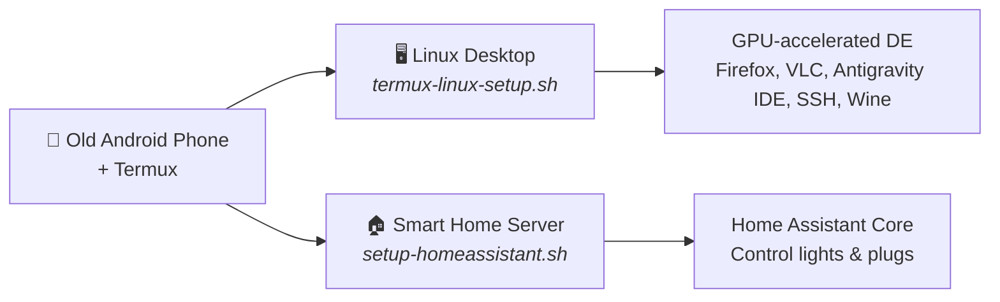

# Linux on Android — Repurpose Your Old Phone

This is the maintained fork at [VLADIMIRCOMMRAD/linux-android](https://github.com/VLADIMIRCOMMRAD/linux-android), based on [mayukh4/linux-android](https://github.com/mayukh4/linux-android). The original project, license and video credits are retained. Install commands below download this fork's fixes.

### Fixes in this fork

- Fix the launcher-generation hang reported in upstream [#10](https://github.com/mayukh4/linux-android/issues/10), related to the Step 9 investigation in [#7](https://github.com/mayukh4/linux-android/issues/7). Creating launchers no longer runs PulseAudio or Termux-X11 accidentally.
- Generate a valid KDE startup command and check required commands before starting a desktop.
- Install Openbox with LXQt and set it as the default window manager when no custom selection exists.
- Disable optional LXQt Power Management autostart by default to avoid recurring crashes observed on Android, while preserving existing user overrides.
- Preserve existing Home Assistant configuration when rerunning setup and report required installation failures.
- Exercise generated launchers and failure paths with automated regression tests.

The ADB/Bluetooth proposal in upstream [#11](https://github.com/mayukh4/linux-android/issues/11) is a feature request, not an implemented capability of this fork. Installing ADB alone does not expose Android Bluetooth or USB devices to Home Assistant.

[](https://github.com/VLADIMIRCOMMRAD/linux-android/actions/workflows/shellcheck.yml)
[](LICENSE)
[](https://termux.dev)
[](https://f-droid.org/en/packages/com.termux/)
[](https://github.com/VLADIMIRCOMMRAD/linux-android/stargazers)
[](https://unshittify.dev/p/linux-android/)

Turn any old Android phone or tablet into a **Linux desktop** or a **smart home server** — no PC, no root, no cloud. Just [Termux](https://termux.dev).

One script installs a **GPU-accelerated desktop** (XFCE4, LXQt, MATE or KDE Plasma) using native Termux packages and Termux-X11 — with Turnip/Zink hardware acceleration on Snapdragon, Firefox, VLC, **Google Antigravity IDE** (bundled via an Ubuntu `proot-distro` glibc bridge), Python, SSH, and optional Wine for Windows apps. A second script turns the phone into an always-on **Home Assistant** server with HACS.

### Quick start

In [Termux from F-Droid](https://f-droid.org/en/packages/com.termux/), with the [Termux-X11 app](https://github.com/termux/termux-x11/releases) installed:

```bash
pkg update && pkg upgrade -y && pkg install -y curl && curl -fsSL https://raw.githubusercontent.com/VLADIMIRCOMMRAD/linux-android/main/termux-linux-setup.sh | bash
```

Then `bash ~/start-linux.sh` and open Termux-X11. Home Assistant instead? Swap in `setup-homeassistant.sh`. Full walkthrough [below](#installation).

> Created to accompany a YouTube video walkthrough. Timestamps are referenced in the video description.



### Pick your path

| | Linux Desktop | Smart Home Server |
|---|---|---|
| **What** | Full GUI desktop environment on your phone | Home Assistant hub that controls WiFi devices |
| **Use cases** | Learning Linux, Python dev, SSH server, web browsing, media | Control smart lights/plugs, automation, dashboards |
| **Script** | `bash termux-linux-setup.sh` | `bash setup-homeassistant.sh` |
| **Time** | 10–30 min | 15–45 min |
| **Jump to** | [Desktop setup](#installation) | [Home Assistant setup](#home-assistant--smart-home-server) |

You can run both on the same phone — they don't conflict.

### Watch the full build

[](https://youtu.be/tYm2rQpkOcg)

**▶ [Repurpose Your Old Android Phone — full walkthrough](https://youtu.be/tYm2rQpkOcg)** — every step in this README, on video, with timestamps in the description.

---

## Requirements

### Hardware
- Android phone with an **arm64 (64-bit)** processor
- **3 GB+ RAM** recommended (4 GB+ for KDE Plasma)
- **5–10 GB** of free storage (more if you install Wine)
- A **Qualcomm Snapdragon** chip is ideal — it enables the best GPU acceleration (Turnip/Adreno). The script works on Mali/other GPUs too but performance will be lighter.

### Software
| App | Where to Get It |
|---|---|
| **Termux** | [F-Droid](https://f-droid.org/en/packages/com.termux/) or [official GitHub releases](https://github.com/termux/termux-app/releases) |
| **Termux-X11** | [GitHub Releases](https://github.com/termux/termux-x11/releases) — download the latest `.apk` |

> **Note on rooting / custom ROMs:** This script works on stock Android too. The video demonstrates it running on **LineageOS** on a OnePlus 5T. Rooting is not required by the script itself.

The Google Play build is a separate experimental branch with different behavior; this guide targets F-Droid/GitHub builds. Keep Termux plugin apps such as Termux:API from the same source as Termux. See the [official installation guidance](https://github.com/termux/termux-app#installation).

---

## Desktop Environments — Which One to Choose?

| # | Desktop | Best For | Resource Usage |
|---|---|---|---|
| 1 | **XFCE4** *(default)* | Most users. Fast, customizable, macOS-style dock | Low–Medium |
| 2 | **LXQt** | Old or low-RAM phones (2–3 GB) | Very Low |
| 3 | **MATE** | Classic desktop feel | Medium |
| 4 | **KDE Plasma** | Powerful phones only — Windows 11 style | High |

If you're unsure, go with **XFCE4**.

LXQt uses **Openbox** for X11 window management. The installer configures it on first setup and preserves an existing custom window-manager choice. Its optional Power Management module is disabled by default because Android manages the phone's battery and screen; an existing user autostart override is preserved.

---

## Installation

### Step 1 — Install required apps

Install **Termux** from F-Droid and **Termux-X11** from GitHub (links above). The Termux-X11 Android APK and the `termux-x11-nightly` package installed by the script are both needed.

### Step 2 — Pre-upgrade Termux (important — do this first)

Open Termux and run:

```bash
termux-wake-lock
pkg update && pkg upgrade -y
pkg install -y curl
```

The `termux-wake-lock` command keeps Termux alive when your screen turns off — without it, Android can kill the process mid-install. The `pkg upgrade` brings your base system up to date before the script runs, preventing a known crash involving `libpcre` and `libandroid-selinux`.

### Step 3 — Run the script

```bash
curl -fsSL https://raw.githubusercontent.com/VLADIMIRCOMMRAD/linux-android/main/termux-linux-setup.sh | bash
```

The script will ask you to choose a desktop environment and whether you want Wine. Everything else is automatic.

Prefer to read it before running it? Download first:

```bash
curl -fL -o termux-linux-setup.sh https://raw.githubusercontent.com/VLADIMIRCOMMRAD/linux-android/main/termux-linux-setup.sh
less termux-linux-setup.sh
bash termux-linux-setup.sh
```

Installation takes **10–30 minutes** depending on your internet speed. Each package shows a live timer and the latest download line. The desktop install log is `~/termux-setup.log`. Rerunning skips installed packages and regenerates launcher/GPU files; back up any edits you made to those generated files first.

<details>
<summary>Unattended install (no questions)</summary>

Pass choices as flags, and `-y` to accept defaults for anything not given:

```bash
curl -fsSL https://raw.githubusercontent.com/VLADIMIRCOMMRAD/linux-android/main/termux-linux-setup.sh | bash -s -- --de kde --no-wine -y
```

| Flag | Meaning |
|---|---|
| `--de xfce\|lxqt\|mate\|kde` | Desktop to install (default `xfce`) |
| `--antigravity` / `--no-antigravity` | Google Antigravity IDE via Ubuntu proot (default: yes) |
| `--wine` / `--no-wine` | Windows app support (default: no) |
| `-y`, `--yes` | Don't ask anything |
| `-h`, `--help` | Show all options |

`setup-homeassistant.sh` takes `--hacs` / `--no-hacs` and `-y` the same way.
</details>

### Step 4 — Start your desktop

```bash
bash ~/start-linux.sh
```

Then **open the Termux-X11 app** on your phone. Your Linux desktop will appear inside it.

To stop:

```bash
bash ~/stop-linux.sh
```

---

## What Gets Installed

| Component | Details |
|---|---|
| **Termux-X11** | Display server — renders your desktop on screen |
| **Desktop Environment** | Your choice: XFCE4, LXQt, MATE, or KDE |
| **Mesa / Zink** | OpenGL via Vulkan — enables GPU-accelerated graphics |
| **Turnip driver** | Qualcomm Adreno open-source Vulkan driver (if detected) |
| **D-Bus** | Session message bus — required by every desktop's settings daemon |
| **PulseAudio** | Audio server |
| **Firefox** | Full desktop web browser |
| **VLC** | Video and audio player |
| **Google Antigravity IDE** *(default)* | AI-first IDE installed in a shared Ubuntu `proot-distro` glibc runtime with a native desktop shortcut and `antigravity-ide` command |
| **Git, wget, curl** | Standard developer tools |
| **Python 3 + pip** | Python runtime and package manager |
| **OpenSSH** | SSH server and client — remote access from your PC |
| **Wine** *(optional)* | Run Windows x86 apps via Hangover + Box64 |

---

## GPU Acceleration

The script detects your GPU automatically using hardware properties (not brand name — Samsung ships both Adreno and Mali phones depending on region, so brand detection is unreliable).

**Qualcomm Adreno (Snapdragon phones):** Uses the open-source **Turnip** Vulkan driver + **Zink** (OpenGL on Vulkan). Near-native GPU performance.

**Mali / Other GPUs:** Falls back to **Zink + SwRast** (software Vulkan). Functional but lighter desktops (XFCE4, LXQt) are strongly recommended.

Zink comes from Termux's own `mesa` package (`$PREFIX/lib/dri/zink_dri.so`), which has shipped it since Mesa 23. The script only falls back to the third-party `mesa-zink` build on installs whose Mesa genuinely lacks Zink, or that already have `mesa-zink` from an earlier run — the two stacks ship the same library filenames and cannot be mixed.

The GPU environment is saved in `~/.config/linux-gpu.sh` and loaded automatically on every `start-linux.sh`. You can edit that file to tweak Mesa flags.

Check what the desktop is actually using, from a terminal inside the desktop:

```bash
# Which Vulkan driver did the loader pick?
vulkaninfo --summary | head -30

# Which OpenGL renderer is in use? Should say "zink"
glxinfo -B | grep -i "renderer\|opengl version"
```

---

## SSH — Access Your Phone from a PC or Laptop

OpenSSH is installed automatically by the script. This lets you SSH into your phone from any computer on the same Wi-Fi network — useful for running commands, transferring files, or doing development work on a proper keyboard.

### First-time SSH setup

Open a terminal in Termux (not inside the desktop — the regular Termux app) and run:

```bash
# Start the SSH server
sshd

# Set your Termux password (you'll use this to log in over SSH)
passwd
```

Find your phone's IP address:

```bash
ip addr show wlan0 | grep 'inet '
```

The output will look like `inet 192.168.1.42/24` — your IP is the part before the `/`.

### Connect from your PC or laptop

On your computer (Linux, macOS, or Windows with Terminal):

```bash
ssh your-termux-username@192.168.1.42 -p 8022
```

> **Port 8022** is the default Termux SSH port (not the standard port 22, which requires root).

To find your Termux username, run `whoami` in Termux. On most setups it will be something like `u0_a123`.

### Simplified login with SSH config (optional)

On your PC, add this to `~/.ssh/config` to avoid typing the full command every time:

```
Host myphone
    HostName 192.168.1.42
    User u0_a123
    Port 8022
```

Then you can connect with just:

```bash
ssh myphone
```

### File transfer with SCP or SFTP

Copy a file from your PC to your phone:

```bash
scp -P 8022 myfile.txt u0_a123@192.168.1.42:~/
```

Copy a file from your phone to your PC:

```bash
scp -P 8022 u0_a123@192.168.1.42:~/somefile.txt ./
```

Or use any SFTP client (like FileZilla or Cyberduck) — connect to the same IP and port 8022.

### Keep SSH running when you close Termux

By default `sshd` stops when Termux is closed. To keep it running persistently:

```bash
# Add to your ~/.bashrc so sshd auto-starts whenever Termux opens
echo 'sshd 2>/dev/null' >> ~/.bashrc
```

---

## Google Antigravity IDE

By default, `termux-linux-setup.sh` bundles **Google Antigravity IDE** alongside Terminal, Firefox, and VLC — pass `--no-antigravity` to skip it.

Because Google Antigravity IDE is a Linux Electron/VS Code build requiring **glibc >= 2.28** (while native Termux uses Android's Bionic libc), the installer sets up a lightweight hybrid bridge:

- Installs `proot-distro` and reuses the shared `ubuntu` container (fully compatible with `setup-homeassistant.sh`).
- Installs the required GTK3/X11/NSS/font runtime libraries inside Ubuntu (handling Ubuntu 24.04+ `*t64` package names automatically).
- Downloads the official Linux ARM64 (or x64) `Antigravity IDE.tar.gz` into `/opt/antigravity-ide` inside Ubuntu.
- Generates `~/start-antigravity.sh` (symlinked as `antigravity-ide`), `~/upgrade-antigravity.sh`, and desktop/menu launchers (`~/Desktop/Antigravity_IDE.desktop`) that share Termux-X11 (`--shared-tmp`), PulseAudio (`127.0.0.1`), and persistent settings (`~/.config/Antigravity`).

### Launching and upgrading

Click the **Antigravity IDE** icon on your desktop, or run from a terminal inside the desktop:

```bash
antigravity-ide
# or open a project folder:
antigravity-ide ~/my-project

# Upgrade Antigravity IDE later:
bash ~/upgrade-antigravity.sh
```

### Android notes for Antigravity IDE

- **OAuth sign-in:** Links are opened via `termux-open-url` / Firefox and logged to `~/antigravity-oauth-url.log` so you can always copy-paste the sign-in URL manually if needed.
- **GPU acceleration inside PRoot:** The launcher passes `--disable-gpu` by default to prevent blank Electron windows inside `proot-distro`. To test hardware rendering, run `ANTIGRAVITY_GPU=1 antigravity-ide`.
- **39-bit ARM64 Android kernels:** Some older/stock Android kernels restrict user-space virtual memory to 39-bit (`CONFIG_ARM64_VA_BITS=39`). While the IDE window runs in PRoot, Google's bundled TCMalloc-based language server binary can report `MmapAligned() failed` on 39-bit kernels (devices with 48-bit VA kernels are unaffected).

---

## Windows App Support (Wine)

If you chose to install Wine, it uses **Hangover Wine** with **Box64** to translate Windows x86 calls to ARM64. Simple tools and utilities tend to work; heavy software or games may not.

To configure Wine, run `winecfg` in your desktop terminal or click the Wine Config shortcut on your desktop.

---

## Home Assistant — Smart Home Server

Turn your old Android phone into an **always-on smart home hub** that controls WiFi smart lights, plugs, and other devices — accessible from any browser on your network.

Home Assistant Core runs inside a lightweight Ubuntu container (via proot-distro) on your phone. No root, no cloud dependency for local devices.

### What it can control

| Device Type | Brand Examples | How it connects |
|---|---|---|
| **WiFi smart lights** | TP-Link Kasa, Govee, LIFX | Direct IP on your local network |
| **WiFi smart plugs** | TP-Link Kasa, Wemo | Direct IP on your local network |
| **Cloud-connected devices** | Tuya / Smart Life, Govee | Via cloud API (works everywhere) |
| **Other WiFi devices** | Smart switches, sensors, cameras | By IP or cloud integration |

### Limitations on Android

- **No Bluetooth** — HA cannot access the phone's Bluetooth stack through Termux
- **No USB dongles** — Zigbee/Z-Wave USB sticks won't work without root and kernel support
- **No auto-discovery (mDNS)** — Android 10+ blocks `/proc/net/dev`, which breaks Zeroconf. You must add devices by IP address or cloud API instead of relying on automatic detection
- **No Docker/Add-ons** — This is HA Core, not HA OS. Community add-ons that require Docker won't work. Core integrations (2000+) work fine.

### Installation

```bash
curl -fsSL https://raw.githubusercontent.com/VLADIMIRCOMMRAD/linux-android/main/setup-homeassistant.sh | bash
```

Unattended: `... | bash -s -- --hacs -y`. Run `bash setup-homeassistant.sh --help` for all options.

The Home Assistant installation log is `~/homeassistant-setup.log`. Installation takes **15–45 minutes** depending on your phone. The longest step is compiling Home Assistant's Python dependencies (numpy, cryptography, etc.) inside the Ubuntu container.

### Starting and stopping

```bash
# Start Home Assistant
bash ~/start-homeassistant.sh

# Stop Home Assistant
bash ~/stop-homeassistant.sh

# Upgrade to the newest version your container's Python supports
bash ~/upgrade-homeassistant.sh
```

### HACS — community integrations and themes

According to the [HACS installation documentation](https://www.hacs.xyz/docs/use/download/download/), Home Assistant 2026.11 and newer includes HACS as Marketplace. The installer skips the legacy custom integration on those versions. On 2026.10 and older, choose `--hacs` to install it. Existing custom integrations are preserved; there is no need to delete `custom_components/`.

For the legacy HACS integration, restart Home Assistant and finish setup in the dashboard:

1. **Settings → Devices & Services → + Add Integration**
2. Search for **HACS**
3. Tick all the acknowledgements, then authorize with your GitHub account

Full configuration docs: [hacs.xyz/docs/use/configuration/basic](https://www.hacs.xyz/docs/use/configuration/basic/).

### Upgrading Home Assistant

Run these commands in **Termux**. The configuration and virtual environment live at `$HOME/hass-config` and `$HOME/hass-venv` in Termux and are bound into Ubuntu at the same absolute paths. Ubuntu's `~` normally means `/root`, which is a different directory. Rerunning setup preserves an existing `configuration.yaml`.

```bash
bash ~/upgrade-homeassistant.sh
```

**Why a fresh install may land on an older version than the HA website shows.** `pip` installs the newest release whose `requires-python` your interpreter satisfies, then stops. It is not a failed install:

| Container Python | Newest Home Assistant you can run |
|---|---|
| 3.12 | 2025.1.x |
| 3.13.0 – 3.13.1 | 2025.5.x |
| 3.13.2+ | **2026.2.x** |
| 3.14.2+ | 2026.3 and later |

(Verified against each release's `requires-python` on PyPI.)

`proot-distro install ubuntu` tracks a rolling Ubuntu release, so which Python you get depends on when you installed the container. `bash ~/upgrade-homeassistant.sh` prints your Python version and tells you if you have hit the ceiling.

Home Assistant Core in a Python virtual environment is an [unsupported installation method](https://www.home-assistant.io/blog/2025/05/22/deprecating-core-and-supervised-installation-methods-and-32-bit-systems/). This script is an experimental Termux setup, and individual integrations can have additional platform requirements.

If your Python is too old, back up `~/hass-config` before changing the Ubuntu interpreter. Create and test a separate virtual environment, then update **both** generated start and upgrade scripts to its absolute path. The installer does not migrate interpreters automatically. Avoid running two HA instances against the same configuration.


### Accessing the dashboard

Once HA is running, open a browser on **any device on your WiFi network** and go to:

```
http://<your-phone-ip>:8123
```

Find your phone's IP with `ip addr show wlan0 | grep 'inet '` in Termux.

The first launch takes **5–10 minutes** to initialize. You'll create your admin account in the browser on first visit.

### Adding your first device — TP-Link Kasa

1. Open the Kasa app on your regular phone and note the device's IP address (Device Settings → Device Info)
2. In HA dashboard: **Settings → Devices & Services → + Add Integration**
3. Search for **"TP-Link Kasa Smart"**
4. Enter the device IP address when prompted
5. Your light/plug should appear — you can now control it from the HA dashboard

> Since mDNS is disabled on Android, auto-discovery won't find devices. Always add by IP.

### Adding Tuya / Smart Life devices

Use the [official Tuya integration setup](https://www.home-assistant.io/integrations/tuya/):

1. Add your devices to the Tuya Smart or Smart Life app.
2. Find **Me → Settings → Account and Security → User Code** in that app.
3. In Home Assistant, choose **Settings → Devices & Services → Add Integration → Tuya**.
4. Enter the User Code and scan the displayed QR code with the app. A second screen helps.

This integration uses Tuya's cloud service; it requires internet access.

### Keeping Home Assistant running in the background

By default, Android kills Termux processes when the app is backgrounded. To keep HA running 24/7:

```bash
# Option 1: Run in background with nohup
termux-wake-lock
nohup bash ~/start-homeassistant.sh > ~/hass.log 2>&1 &

# Option 2: Auto-start on Termux launch (add to ~/.bashrc)
echo 'termux-wake-lock && nohup bash ~/start-homeassistant.sh > ~/hass.log 2>&1 &' >> ~/.bashrc
```

`termux-wake-lock` prevents Android from suspending the process. Plug your phone into a charger and it becomes a dedicated always-on server.

---

## Video Use Cases

Ideas for what you can do with your old Android phone running this setup:

- **Smart home controller** — plug it in, run Home Assistant 24/7, control your lights and plugs from any device on your network
- **Linux desktop for learning** — a full XFCE4/KDE/MATE desktop to learn Linux without buying a PC
- **SSH development server** — code on your laptop, run on your phone over SSH
- **Python development workstation** — Python 3 + pip ready to go, great for learning or small projects
- **Media server / file server** — serve files over your local network using Python's built-in HTTP server or install Samba
- **Network monitoring dashboard** — access Home Assistant and system stats from any browser

---

## Troubleshooting

**Stuck at “Setting up scripts” / Step 9, or “No valid command specified”**
This is a launcher-generation bug in the upstream version, not a slow download. Backticks in an unquoted here-document executed commands from comments while writing `start-linux.sh`. This fork uses literal templates so those commands only run when you start the desktop.

Stop the old installer with Ctrl+C. In Termux, download the fixed script from **this fork**, then rerun it with your original desktop choice (replace `xfce` with `lxqt`, `mate`, or `kde` if needed):

```bash
curl -fL -o ~/termux-linux-setup.sh https://raw.githubusercontent.com/VLADIMIRCOMMRAD/linux-android/main/termux-linux-setup.sh &&
bash ~/termux-linux-setup.sh --de xfce --no-wine -y
```

Installed packages are skipped. The launcher files are regenerated. Then run `bash ~/start-linux.sh` and open Termux-X11. If the displayed step explicitly says **Installing Hangover Wine**, use the download troubleshooting below instead; step numbers depend on the selected options.

**The install looks stuck on one step**
Big packages (KDE Plasma, Firefox, Wine) are hundreds of MB and can take 10+ minutes on a slow connection or phone. The spinner shows the elapsed time and the latest line from apt — if that line keeps changing, it is working. If nothing moves for 5 minutes the script prints a warning. Then:

- Keep Termux in the foreground with the screen on, and make sure `termux-wake-lock` is active.
- Check the live log from a second Termux session (swipe from the left edge → New session): `tail -f ~/termux-setup.log`
- Press `Ctrl+C` and re-run the script. Already-installed packages are skipped, so you lose nothing.
- If one mirror is slow, pick another with `termux-change-repo`.

**Termux closes with "[Process completed (signal 9)]" (Android 12+)**
Android 12 added a "phantom process killer" that kills background processes Termux starts. On **Android 14+**, turn on *Developer options → Disable child process restrictions*. On Android 12–13, run this once from a PC with [ADB](https://developer.android.com/tools/adb):

```bash
adb shell "/system/bin/device_config set_sync_disabled_for_tests persistent; /system/bin/device_config put activity_manager max_phantom_processes 2147483647"
```

**Script exits mid-install without a clear error**
Check `~/termux-setup.log`. The script logs every package install result. The last line will tell you exactly which package triggered the failure.

**Desktop doesn't appear after running start-linux.sh**
Open the Termux-X11 app manually — the desktop renders inside that app, not in the Termux terminal itself.

**LXQt shows “Please select your default Window Manager” with only “Other”**
Older scripts installed LXQt without a window manager. Rerun the current script with `--de lxqt --no-wine -y` to install Openbox and fill in an unset default. Then restart with `bash ~/stop-linux.sh` followed by `bash ~/start-linux.sh`. For a manual repair, run `pkg install openbox` in Termux. In the LXQt dialog, choose **Other** and select `/data/data/com.termux/files/usr/bin/openbox` in the file picker (or the path printed by `command -v openbox` for a custom Termux installation). Typing only `openbox` in the file picker may search the wrong directory. A nonempty custom selection in `~/.config/lxqt/session.conf` is preserved.

**LXQt: “Power Management crashed too many times” on each login**
The desktop can continue without this optional module. The current installer creates a disabled user autostart entry for it; rerun with `--de lxqt --no-wine -y` and restart the desktop. Existing user overrides are preserved, so if you already customized this module, open **Session Settings → Basic Settings → LXQt Modules**, uncheck **Power Management**, and apply the change. You can open Session Settings by running `lxqt-config-session` in QTerminal. The **Stop** button alone only stops the current session.

The persistent setting is `X-LXQt-Autostart-disabled=true` in `~/.config/autostart/lxqt-powermanagement.desktop` (under `$XDG_CONFIG_HOME` if set). This changes only LXQt's optional daemon; Android's battery and screen settings remain in effect. You can explicitly re-enable the module in Session Settings, and installer reruns keep that user override. No other LXQt modules are disabled by this fix.

**Black screen in Termux-X11**
Run `stop-linux.sh` then `start-linux.sh` again. KDE Plasma can take 20–30 seconds longer than other DEs on first boot.

**"library not found" or "cannot link executable" error during install**
This is the libpcre crash. Close Termux completely, reopen it, run `pkg upgrade -y`, then re-run the script.

**"Unable to contact settings server" / "Failed to connect to socket .../dbus-XXXX: Connection refused"**
The desktop's settings daemon talks over the D-Bus session bus. Either no bus is running, or a previous session was force-killed and left a dead socket behind that the desktop keeps trying to reuse. `start-linux.sh` now clears the stale state and starts a bus at a fixed address before launching the desktop. If you are on an older copy of the script, re-run `termux-linux-setup.sh` to regenerate the launchers, or fix it by hand:

```bash
pkg install dbus
pkill -9 -f dbus-daemon
rm -rf ~/.dbus "$PREFIX"/tmp/dbus-*
mkdir -p "$PREFIX/var/run/dbus"
export DBUS_SESSION_BUS_ADDRESS="unix:path=$PREFIX/var/run/dbus/session_bus_socket"
dbus-daemon --session --address="$DBUS_SESSION_BUS_ADDRESS" --nopidfile --fork
```

**Vulkan / Mesa packages fail: "vulkan-loader-generic : Conflicts: vulkan-loader-android", or dpkg "trying to overwrite libvulkan_freedreno.so"**
Two separate causes, both fixed in the current script:

- `vulkan-loader-generic` both *provides* and *conflicts with* `vulkan-loader-android`, so asking for the android loader on a normal install aborts the whole transaction for no benefit. The script now installs `vulkan-loader-generic`.
- The third-party `mesa-zink-vulkan-icd-freedreno` (Mesa 22) ships the same `libvulkan_freedreno.so` as the main-repo Turnip driver (Mesa 26), so installing both makes dpkg abort. The script now picks one stack and stays on it.

If your install predates this fix, GPU acceleration probably still worked — those two failures are loud but not fatal. Re-running the script cleans it up.

**Package install fails with "unmet dependencies" or "Conflicts"**
The script's `safe_install_pkg` function reads each package's declared conflicts, evaluates version constraints properly, and lets apt perform conflicts the package legitimately replaces. If you still see this, check the log and open a GitHub issue with your device model and Android version.

**Audio not working**
Wait 5–10 seconds after the desktop appears. PulseAudio needs a moment to initialize on first start.

**SSH connection refused**
Make sure `sshd` is running (`ps aux | grep sshd`). If not, run `sshd` again. Confirm you're using port 8022, not 22.

**Wine doesn't launch**
Wine needs an active display. Make sure your desktop is running first, then run `winecfg` from the terminal inside the desktop.

**Home Assistant: "pip install homeassistant" fails with compilation errors**
This usually means a build dependency is missing. Run `proot-distro login ubuntu` and check that `python3-dev`, `libffi-dev`, `libssl-dev`, and `cargo` are installed. Then rerun the setup script from Termux. Do not use Ubuntu's `~/hass-venv`: the environment is stored under the Termux home directory.

**Home Assistant: dashboard not loading at port 8123**
First launch takes 5–10 minutes. Check if HA is still initializing: `bash ~/start-homeassistant.sh` and watch the output. Make sure your phone and browser are on the same WiFi network.

**Home Assistant: "address already in use" error on startup**
Another HA instance is already running. Stop it first with `bash ~/stop-homeassistant.sh`, or manually: `pkill -f "hass -c"`.

**Home Assistant: devices not discovered automatically**
This is expected on Android. The `/proc/net/dev` restriction on Android 10+ prevents mDNS/Zeroconf from working. Add devices manually by IP address or use cloud-based integrations (Tuya, Govee Cloud, etc.).

---

## FAQ

**Do I need root?** No. Everything runs as a normal Android app. Root is not used by either script.

**Is this a proot / chroot distro like Andronix or UserLAnd?** The desktop is not. It uses native Termux packages and the Termux-X11 display server, so there is no emulation layer between the apps and the phone — that is what makes GPU acceleration through Turnip/Zink possible. Home Assistant does run in a proot-distro Ubuntu container, because it needs a glibc Python environment.

**Will it work on my phone?** Any arm64 (64-bit) Android 7+ phone or tablet with 3 GB+ RAM should work. Qualcomm Snapdragon (Adreno GPU) gets full hardware acceleration; Mali, PowerVR and others fall back to software Vulkan, so pick XFCE4 or LXQt there.

**Can I use the Play Store version of Termux?** This guide targets F-Droid or the [Termux GitHub releases](https://github.com/termux/termux-app/releases). Google Play has a separate experimental build with differences; see the [Termux installation notes](https://github.com/termux/termux-app#installation).

**Can I use a keyboard, mouse and external monitor?** Yes. Bluetooth or USB keyboards and mice work in Termux-X11, and on phones with DisplayPort-over-USB-C (or Samsung DeX) you can put the desktop on a monitor.

**How do I uninstall?** Run `bash ~/stop-linux.sh`, then remove the packages with `pkg uninstall <name>`, or simply clear Termux's app data to start fresh. For Home Assistant, stop it first and back up `~/hass-config`. Only remove the Ubuntu container with `proot-distro remove ubuntu` if you no longer need anything else in that container. The Termux-side `~/hass-venv`, `~/hass-config` and generated launcher files remain; remove them separately only when you no longer need them. Clearing Termux app data removes all Termux files.

---

## Advanced Notes

<details>
<summary>Customize GPU flags</summary>

`~/.config/linux-gpu.sh` is sourced on every desktop start. Common tweaks:

```bash
# Force software rendering (for debugging)
export GALLIUM_DRIVER=llvmpipe

# Enable Mesa debug output
export MESA_DEBUG=1

# Change OpenGL version override
export MESA_GL_VERSION_OVERRIDE=3.3
```
</details>

<details>
<summary>SSH key authentication (passwordless login)</summary>

On your PC, generate a key pair if you don't have one:

```bash
ssh-keygen -t ed25519
```

Copy your public key to your phone:

```bash
ssh-copy-id -p 8022 u0_a123@192.168.1.42
```

After this, SSH will no longer ask for a password.
</details>

<details>
<summary>Auto-start desktop when Termux opens</summary>

Add to `~/.bashrc` in Termux:

```bash
# Uncomment to auto-launch desktop on Termux open
# bash ~/start-linux.sh
```
</details>

<details>
<summary>How the conflict-safe installer works</summary>

Termux has several packages that hard-conflict with each other (for example `vulkan-loader-android` and `vulkan-loader-generic` declare a mutual `Conflicts`). Standard `apt-get` fails loudly when you install one while the other is present, which would exit the script mid-run.

`safe_install_pkg` reads each package's metadata from `apt-cache show` before installing and decides what to do:

1. **Already installed, or already provided.** `vulkan-loader-generic` *provides* `vulkan-loader-android`, so asking for the latter is already satisfied — no install needed.
2. **Version constraints are honoured.** `Conflicts: ndk-sysroot (<< 23b-6)` only applies below `23b-6`, evaluated with `dpkg --compare-versions`. Treating that as an unconditional conflict used to skip packages that would have installed fine.
3. **Replacements are allowed through.** A package that declares `Replaces:`/`Provides:` the thing it conflicts with is a supported swap, and apt handles it.
4. **Genuine conflicts are skipped** with a warning, and the script continues.

The result: the script is safe to run on any Termux setup regardless of what was pre-installed, without silently skipping things it should have installed.
</details>

<details>
<summary>About the Termux path</summary>

All hardcoded `/data/data/com.termux/...` paths have been replaced with `$PREFIX` (the standard Termux environment variable). This means the script works on non-standard installs such as Termux on a secondary Android user profile.
</details>

---

## Contributing

PRs and issues are welcome. If a package name has changed, a DE has a better startup command, or you've found a new conflict to handle, open an issue with your device model and Android version. See [CONTRIBUTING.md](CONTRIBUTING.md).

**Tested it on your device?** Even a one-line "works on Pixel 6 / Android 15 / XFCE4" report helps the next person — open an issue or comment on an existing one.

---

## Read this in other languages

If you would prefer to read this in Chinese, the full translation is here: **[中文文档 / Chinese documentation](README.zh.md)**.

Translations of the README into other languages are welcome — open a PR with a `README.<lang>.md` file and I will link it here.

---

## Support this project

If this saved you buying a Raspberry Pi, you can [sponsor the work on GitHub](https://github.com/sponsors/mayukh4). Starring the repo helps too — it is what gets it in front of the next person looking to do this.

---

## License

MIT — use and modify freely.
